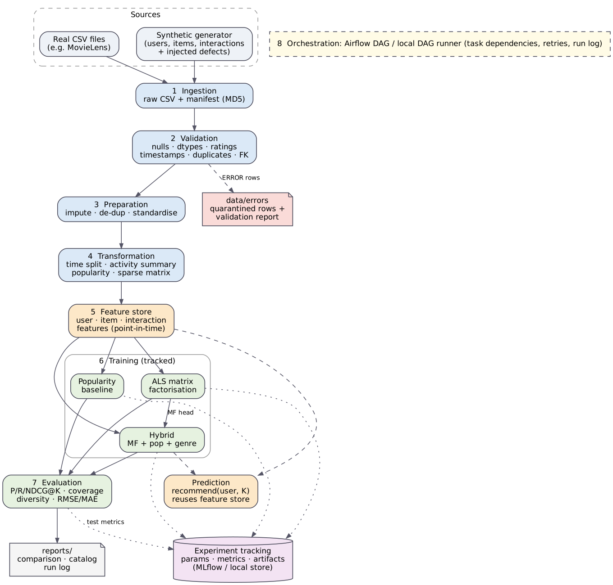

# End-to-End Data Management Pipeline for a Recommendation System

DM4ML Assignment 2. A modular, reproducible pipeline:

`Ingestion → Validation → Preparation → Transformation → Feature Management → Training → Evaluation → Orchestration`



## Quick start

```bash
python -m venv .venv && source .venv/bin/activate
pip install -r requirements.txt          # core deps only need numpy/pandas/scipy/pyyaml/matplotlib
python run_pipeline.py                   # full run, ~12 s: writes data/, models/, mlruns/, reports/
python -m unittest discover -s tests -v  # 7 unit tests
python -m src.reporting.final_report     # rebuilds reports/final_report.pdf from the latest results
python -m src.training.predict --user U00010 --k 10   # recommendations for one user (unknown IDs = cold start)
```

Partial runs: `python run_pipeline.py --from-stage build_features` or `--only train_mf evaluate_models`.
Graphviz (`dot`) is only needed to re-render the architecture diagram (`make arch`).

## Data

Default is a **documented synthetic generator** (`src/ingestion/synthetic.py`): 1,200 users, 600 items, ~50k timestamped
ratings with latent taste structure, plus _deliberately injected defects_ logged in `data/raw/_injected_defects.json`
so validation can be checked against ground truth. To use real data (e.g. MovieLens) map it to three CSVs
(`users.csv: user_id,age,gender,country,signup_date`, `items.csv: item_id,title,genres(pipe-separated),release_year`,
`interactions.csv: user_id,item_id,rating,timestamp`), then set `data.source: csv` and `data.csv_dir` in `configs/config.yaml`.

## Stages and outputs

| Stage                | Code                                                                   | Main outputs                                                                                                                           |
| -------------------- | ---------------------------------------------------------------------- | -------------------------------------------------------------------------------------------------------------------------------------- |
| 1 Ingestion          | `src/ingestion/`                                                       | `data/raw/*.csv`, `_manifest.json` (rows, columns, MD5)                                                                                |
| 2 Validation         | `src/validation/validate.py`                                           | `data/interim/*_valid.csv`, `data/errors/*_rejected.csv`, `data/errors/validation_issues.csv`, **`reports/data_validation_report.md`** |
| 3 Preparation        | `src/preparation/clean.py`                                             | `data/processed/{users,items,interactions}.csv`, `reports/cleaning_summary.json`                                                       |
| 4 Transformation     | `src/transformation/split_derive.py`                                   | `train.csv`, `test.csv` (time split), `user_activity_summary.csv`, `item_popularity.csv`, `interaction_matrix.npz`                     |
| 5 Feature management | `src/features/store.py`, `configs/feature_registry.yaml`               | `data/features/*.csv`, **`reports/feature_catalog.md`**                                                                                |
| 6 Training           | `src/training/`                                                        | `models/*.pkl`, runs in `mlruns/`, `reports/hybrid_weight_search.csv`                                                                  |
| 7 Evaluation         | `src/evaluation/`                                                      | **`reports/model_comparison.md/.csv/.json`**, `figures/model_comparison.png`                                                           |
| 8 Orchestration      | `src/orchestration/pipeline.py`, `dags/recommendation_pipeline_dag.py` | `reports/pipeline_run_log.json`, `figures/dag_run.png`                                                                                 |

## Design notes

- **Validation** – ERROR rows (bad/missing keys, invalid or out-of-range rating, unparsable/future/pre-signup timestamp,
  orphan foreign keys, duplicates) are quarantined with the violated rule; WARN fields (age, country, title, genres, release year)
  are blanked, logged and imputed in preparation. `rows_in = valid + quarantined` is asserted.
- **No leakage** – split is by time (newest 20% = test); all features are computed as-of the last training timestamp;
  hybrid blend weights are tuned on a validation window cut from the _end of train_, never on test.
- **Feature layer** – `FeatureStore.build/save/load/get_*` is the only code that computes features and is used by training,
  evaluation and `predict.py`. A registry check fails the build if code and `feature_registry.yaml` drift apart.
- **Models** – popularity baseline; ALS matrix factorisation (biased, explicit ratings, NumPy); hybrid = per-user z-scored
  blend of MF score, log-popularity and genre affinity.
- **Metrics** – Precision/Recall/NDCG@K (K=5,10), Coverage, intra-list Diversity (genre cosine), RMSE/MAE. Relevant = test rating ≥ 4.
- **Tracking** – params, metrics and the model artifact are logged per model. The default `tracking.backend: local` uses the built-in
  MLflow-style file store in `mlruns/`; set it to `mlflow` to opt into MLflow when installed.
- **Orchestration** – `build_dag()` is the single workflow definition; `run_dag` executes it (topological order, retries, skip-on-failure, run log),
  and the Airflow DAG file generates the same tasks/dependencies. Run it in Airflow with
  `AIRFLOW__CORE__DAGS_FOLDER=$PWD/dags PYTHONPATH=$PWD airflow dags test recommendation_pipeline 2025-01-01`.

## Results (K=10, test period; full table incl. K=5 in `reports/model_comparison.md`)

See `reports/model_comparison.md`. In short: the hybrid beats the popularity baseline on NDCG/Precision/Recall/Coverage;
MF alone is the best rating predictor (RMSE/MAE) but ranks worse than popularity; the hybrid trades some diversity for accuracy.

## Honest notes / limitations

- The build sandbox had **no internet**, so MLflow, Airflow, Great Expectations/Pandera, Feast, Surprise and Implicit were not installed.
  Validation, the feature store, the models and the tracker are custom equivalents. The Airflow DAG file is syntax-checked and its graph is
  unit-tested, but it was **not run inside Airflow**; the identical tasks were run by the local runner. The MLflow branch of
  `src/tracking/tracker.py` is untested here.
- `reports/figures/dag_run.png` is rendered from the real run log. **Replace/add a screenshot of the Airflow UI** if you run the DAG there
  (the assignment asks for a screenshot of a successful run).
- Data is synthetic, so absolute scores are not comparable with real-world datasets.

## Repository layout

```
configs/ (config.yaml, feature_registry.yaml)   dags/ (Airflow DAG)   data/{raw,interim,processed,features,errors}
src/{ingestion,validation,preparation,transformation,features,training,evaluation,tracking,orchestration,reporting}
models/  mlruns/  reports/ (+figures)  tests/  run_pipeline.py  Makefile  requirements.txt
```
